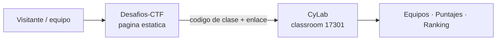

# Desafíos CTF · CyLab

Página web estática intermediaria para una competencia **Capture The Flag (CTF)**.
Su único propósito es **redirigir** a los equipos hacia la plataforma
[CyLab](https://learn.cylabacademy.org/), donde se gestionan los equipos, los
puntajes y el ranking.

- **Clase (classroom):** `17301`
- **Código de acceso:** `CIXkTh3Ay`

Esta página no implementa el CTF: solo muestra un contador regresivo, el
reglamento y los enlaces de acceso a CyLab.



---

## Estructura del proyecto

| Archivo | Responsabilidad |
| --- | --- |
| `index.html` | Estructura y contenido de la página (hero, cronómetro, reglamento, pasos y pie). |
| `style.css` | Estilos con tema oscuro, acento neón y diseño responsive (mobile-first). |
| `script.js` | Cuenta regresiva de la competencia y copiar el código de clase. |

No hay build ni dependencias: los tres archivos se sirven tal cual.

---

## Cómo funciona el contador

El contador usa la **hora actual del navegador**, por lo que sigue siendo
correcto aunque la página se abra tarde o se recargue. Se calcula a partir de
dos constantes de `script.js`:

- `EVENT_START` — momento de inicio de la competencia.
- `DURATION_MS` — duración de la competencia (3 horas).

El contador tiene **tres estados**:

1. **Antes** (`antes`) — aún no comienza. Muestra *"Esperando el inicio"* y el
   tiempo que falta: *"Faltan Xh Ym Zs para que comiencen los desafíos"*.
2. **Durante** (`durante`) — la competencia está en curso. Muestra
   *"Competencia en curso"* y el tiempo restante: *"Quedan Xh Ym Zs de
   competencia"*.
3. **Después** (`despues`) — la competencia terminó. El cronómetro se detiene en
   `00:00:00` y muestra el mensaje final:

   > **¡Tiempo agotado! La competencia ha finalizado.**

---

## Cambiar la hora de inicio

La **única línea que hay que editar** es `EVENT_START` en `script.js`:

```js
// script.js
const EVENT_START = new Date("2026-10-25T14:00:00-03:00");
const DURATION_MS = 3 * 60 * 60 * 1000; // Duración: 3 horas.
```

**Formato:** `"AAAA-MM-DDTHH:MM:SS±HH:MM"` (ISO 8601 con offset de zona
horaria).

- El valor actual es `2026-10-25T14:00:00-03:00`: **25 de octubre de 2026 a las
  14:00, hora de Chile (verano, UTC-3)**.
- La duración se define en `DURATION_MS`. Actualmente son 3 horas
  (`3 * 60 * 60 * 1000`).

> ⚠️ **Zona horaria de Chile:** el offset depende de la estación. En **verano**
> es `-03:00` y en **invierno** es `-04:00`. Si programas una fecha en horario
> de invierno, escribe `-04:00`, por ejemplo:
> `new Date("2026-07-25T14:00:00-04:00")`.

> ℹ️ La fecha también aparece como texto visible en `index.html` (en el párrafo
> del cronómetro y en el aviso `<noscript>`). Recuerda actualizarlos para que
> coincidan con `EVENT_START`.

---

## Cambiar el enlace de la clase o el código de acceso

Ambos están directamente en `index.html`:

**Enlace a CyLab** — aparece dos veces (mismo destino):

- **Línea 29** — botón principal *"Ir a los desafíos en CyLab"*.
- **Línea 157** — enlace *"Abrir CyLab"* del pie de página.

```html
<!-- index.html, línea 29 -->
<a class="boton boton--primario" id="enlace-cylab"
   href="https://learn.cylabacademy.org/classrooms/17301/assignments?status=active&amp;page=1">
```

**Código de acceso** — aparece dos veces (deben coincidir):

- **Línea 43** — valor mostrado en el bloque "Código de clase".
- **Línea 135** — repetido en el paso 2 de "Cómo participar".

```html
<!-- index.html, línea 43 -->
<p class="codigo__valor" id="codigo-clase">CIXkTh3Ay</p>
```

> El botón **"Copiar código"** lee el texto de la línea 43 (elemento
> `#codigo-clase`), así que basta con actualizar ese valor; mantén la línea 135
> sincronizada para que el texto sea consistente.

---

## Despliegue en GitHub Pages

El sitio es **100 % estático**: no requiere build, dependencias ni configuración
adicional.

1. Sube `index.html`, `style.css` y `script.js` a la rama `main`.
2. En el repositorio ve a **Settings → Pages**.
3. En **Source** elige **"Deploy from a branch"**.
4. Selecciona la rama **`main`** y la carpeta **`/ (root)`**.
5. Guarda. GitHub Pages publicará la página en
   `https://<usuario>.github.io/Desafios-CTF/`.

> ℹ️ El repositorio incluye un archivo `.nojekyll` en la raíz para omitir el
> procesado Jekyll de GitHub Pages y publicar los archivos tal cual. Este modo de
> despliegue por rama no usa workflows ni GitHub Actions.

---

## Accesibilidad y responsive

- **Responsive (mobile-first):** los puntos de quiebre en `style.css` están en
  `640px` y `1024px`; el diseño funciona desde 320px hasta 1440px.
- **Accesibilidad:** enlace "Saltar al contenido", foco visible, estructura
  semántica con `header`/`main`/`footer`, región `role="timer"` con
  `aria-live`, utilidad `.sr-only` para lectores de pantalla y contraste WCAG AA.
- **Sin JavaScript:** un bloque `<noscript>` informa la fecha y hora de inicio.
- **Movimiento reducido:** se respeta `prefers-reduced-motion`.

---

## Reglamento (resumen)

El incumplimiento de estas reglas es motivo de revisión por parte del equipo
organizador. Aplican a **todo el equipo**:

1. **No está permitido el uso de IA**, salvo para tener claridad de los desafíos
   (por ejemplo, saber qué tipo de desafío es).
2. **No se puede automatizar** la resolución de los desafíos.
3. **En caso de sospecha de uso indebido de IA**, se consultará al equipo sobre
   el proceso realizado en el desafío.

---

## Licencia

Proyecto educativo para la competencia CTF de CyLab.
